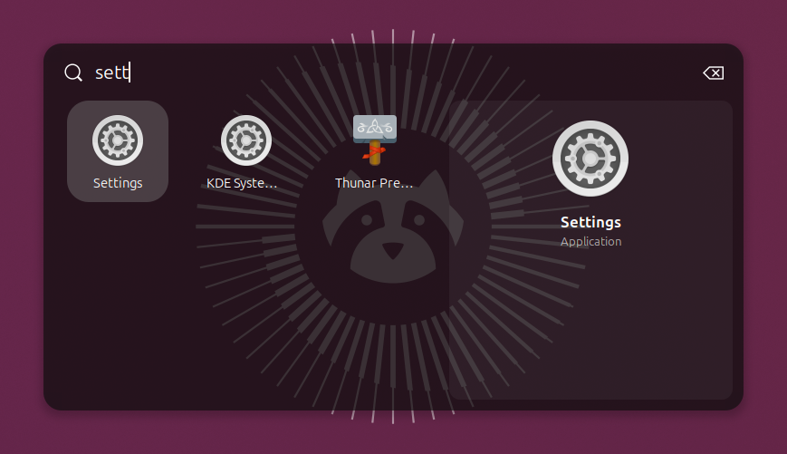
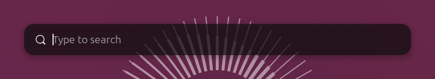
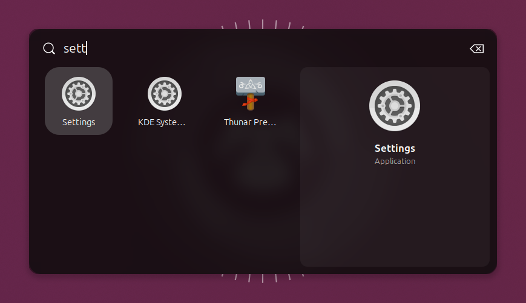
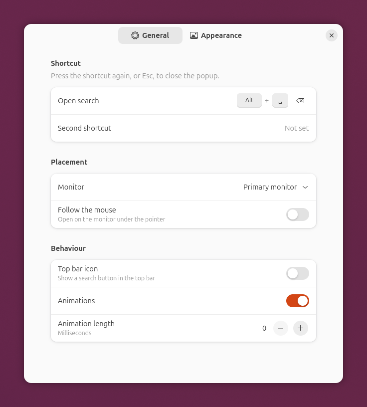
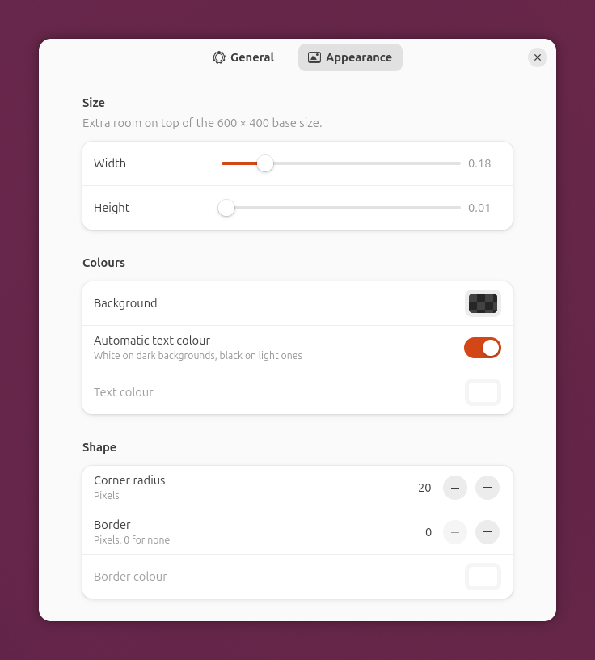

# Search Beam

**A Spotlight-style search popup for GNOME Shell 50.** Press a shortcut and
GNOME's own search opens in a box in the middle of the screen: apps, settings,
files, web results and anything else your search providers offer. You don't
have to go through Activities.



Search Beam started as a replacement for
[Search Light](https://github.com/icedman/search-light), which stopped loading
on GNOME 50. It does the same job and reads the same settings, and is written
from scratch for the current GNOME Shell APIs.

## Features

- **One shortcut, centred popup.** It opens as a slim search bar and grows to
  show results as you type.
- **Uses GNOME's real search.** Every search provider you have (apps, Settings
  panels, Files, Calculator, web search, snaps, other extensions' providers)
  shows up here exactly as it does in Activities.
- **Keyboard first.** Enter opens the top result, the arrow keys and Tab move
  between results, and Esc closes the popup and puts you back in the window you
  were using.
- **Gets out of the way.** It closes when you open a result, click outside or
  switch window, and it never opens Activities by accident.
- **Looks how you want.** Background colour and transparency, text colour,
  corner radius, border, font sizes, size, and an optional blurred-wallpaper
  background.
- **Multi-monitor.** It can open on your primary monitor, a chosen monitor, or
  whichever monitor the pointer is on.
- **Optional top-bar button** for opening it with the mouse.
- **Easy move from Search Light.** One command copies your Search Light
  settings across.

| Compact | Blurred wallpaper |
| --- | --- |
|  |  |

## Requirements

- GNOME Shell **50** (tested on 50.1, Ubuntu 26.04)
- `make`, plus `gnome-extensions` and `glib-compile-schemas`, which come with
  GNOME (on Debian/Ubuntu the latter is in `libglib2.0-bin`)

## Install

1. Download and install it:

   ```sh
   git clone https://github.com/kingsleycj/search-beam.git
   cd search-beam
   make install
   ```

2. **Log out and back in.** On Wayland, GNOME Shell only finds new extensions
   at login. Until then, enabling it fails with "does not exist".
3. Turn it on:

   ```sh
   gnome-extensions enable search-beam@kingsleycj.github.io
   ```

The default shortcut is **Ctrl+Super+Space**. When you update later, run
`make install` again and log out and back in.

## Usage

| Do this | What happens |
| --- | --- |
| Press the shortcut | Open the popup (press it again to close) |
| Type | Search |
| **Enter** | Open the top result |
| **↓ ↑ ← →** / **Tab** | Move between results |
| Click a result | Open it |
| **Esc** | Close and return to the window you were in |
| Click outside, or switch window | Close |
| **Super** | Close (Activities stays closed) |

## Settings

Open them from the Extensions app (the gear next to Search Beam), or run:

```sh
gnome-extensions prefs search-beam@kingsleycj.github.io
```

| | |
| --- | --- |
|  |  |

| Setting | What it does |
| --- | --- |
| Open search / Second shortcut | Shortcuts that toggle the popup. Click a row, then press the new combination: Ctrl, Alt or Super with a key, or an F-key (Backspace clears it). The first time, GNOME asks whether to let Extensions *inhibit shortcuts*. Choose **Allow** so the dialog can record combinations GNOME normally keeps for itself. |
| Monitor | Which monitor to open on |
| Follow the mouse | Open on the monitor under the pointer instead |
| Top bar icon | Show a search button in the top bar |
| Animations / Animation length | Fade-and-zoom when opening and closing |
| Width / Height | Extra room on top of the 600 × 400 base size, as a share of half the monitor |
| Background | Colour and transparency of the popup |
| Automatic text colour / Text colour | White on dark backgrounds and black on light ones, or a colour you pick |
| Corner radius, Border, Border colour | Shape of the popup |
| Text size: search box / results | In points; 0 uses your theme's size |
| Blurred wallpaper, Strength, Brightness | Show a blurred copy of the wallpaper behind the background colour |

### Picking a shortcut that GNOME already uses

If you choose a combination GNOME already uses, the two clash and only one of
them responds, and GNOME doesn't warn you. **Alt+Space** is the usual one: GNOME
uses it to open the window menu. To use it for Search Beam, free it first:

```sh
gsettings set org.gnome.desktop.wm.keybindings activate-window-menu "[]"
```

Then set Alt+Space in Search Beam's settings. You can also check
**Settings → Keyboard → View and Customise Shortcuts** for anything else that
clashes.

## Coming from Search Light

1. Turn Search Light off:
   `gnome-extensions disable search-light@icedman.github.com`
2. Install and enable Search Beam (see [Install](#install)).
3. Copy your settings across. This works any time, even before you've logged
   back in:

   ```sh
   tools/import-search-light.py --dry-run   # show what would be copied
   tools/import-search-light.py             # copy it
   ```

The script copies your shortcuts, colours, size, blur, top-bar icon and
animation settings. Search Light's corner-radius and font-size steps become real
pixel and point values. Every value is checked against Search Beam's limits;
anything out of range is listed and skipped rather than silently dropped. If
you'd picked a specific non-primary monitor, choose it again in the settings,
because the two extensions number monitors differently. Search Light's "window effect" filters and its
unit/currency converter switches have no equivalent here. (The converters never
did anything in Search Light either.)

## Uninstall

```sh
gnome-extensions disable search-beam@kingsleycj.github.io
gnome-extensions uninstall search-beam@kingsleycj.github.io
dconf reset -f /org/gnome/shell/extensions/search-beam/   # optional: forget settings
```

## Troubleshooting

**Nothing happens when I press the shortcut.**
Check that GNOME has loaded it:

```sh
gnome-extensions info search-beam@kingsleycj.github.io
```

- **"does not exist":** you haven't logged out and back in since installing.
- **State isn't ACTIVE:** enable it with `gnome-extensions enable search-beam@kingsleycj.github.io`.
- **ERROR:** see the logs below.
- **ACTIVE but the shortcut does nothing:** another shortcut is probably using
  the same keys (see
  [Picking a shortcut](#picking-a-shortcut-that-gnome-already-uses)).

**It says OUT OF DATE after a GNOME upgrade.**
Search Beam only claims the GNOME versions it has been tested on. Please open
an issue. If you want to try it anyway, add the new version number to
`shell-version` in `metadata.json` and run `make install`.

**Logs.** Errors from Search Beam show up in GNOME Shell's log:

```sh
journalctl -b -o cat _COMM=gnome-shell | grep -i -A8 search-beam
```

## How it works

Search Beam doesn't build a second search UI. While it's open, it borrows the
Overview's search box and results view, places them in the popup, and hands
them back when it closes. That's why every search provider works, and why
Activities search keeps working normally.

Opening a result normally tells the Overview to `toggle()` or `hide()`. While
the popup holds the search, those two calls are briefly redirected to "close
the popup", so picking a result never opens Activities. Everything is put back
when the popup closes or the extension is disabled.

## Development

| File | Purpose |
| --- | --- |
| `extension.js` | Enable/disable, shortcuts, top-bar button |
| `popup.js` | The popup: borrowing and returning the search, layout, styling, blur |
| `prefs.js` | Settings window (GTK 4 / libadwaita) |
| `stylesheet.css` | Base look; colours and sizes from settings are applied on top at runtime |
| `schemas/` | Settings keys (names match Search Light's where they overlap) |
| `tools/import-search-light.py` | Search Light settings importer |
| `test/headless/` | Automated tests in a throwaway GNOME Shell |

```sh
make pack      # build build/search-beam@kingsleycj.github.io.shell-extension.zip
make install   # install it for your user (then log out and back in)
```

### Testing without logging out

`test/headless/` starts a separate, headless GNOME Shell with its own settings,
loads Search Beam in it, and runs 49 checks: opening and closing, clearing
the search, focus returning to the previous window, launching results,
Activities search still working, staying clear of the top bar, blur, disabling
while open, the settings window and the top-bar button. It never touches your running session. See
[test/headless/README.md](test/headless/README.md), and read its note about
when it's safe to stop the test shell.

`test/headless/screenshots.sh` regenerates the images in `docs/`.

## Contributing

Issues and pull requests are welcome. If you change behaviour, please run the
headless suite before sending a pull request, and add a check for the new
behaviour if you can.

## Credits

The idea and the approach (borrowing GNOME's own search instead of rebuilding
it) come from [Search Light](https://github.com/icedman/search-light) by
icedman. Parts of the stylesheet are adapted from it.

## Licence

GPL-2.0-or-later, the same as GNOME Shell and Search Light. See
[LICENSE](LICENSE).
